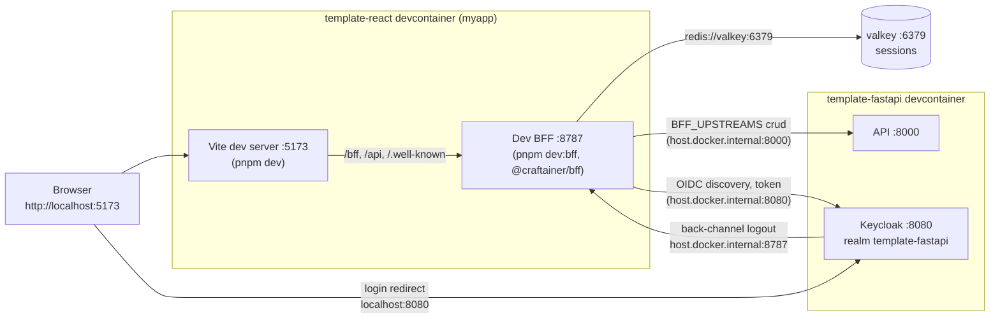
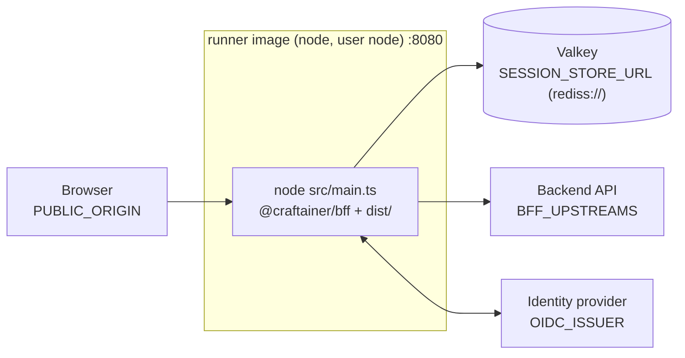

# Architecture

The infrastructure view: which processes and services exist, how they
connect, and how the devcontainer differs from the production image. Why the
BFF exists is in [ADR 0007](adrs/0007-adopt-craftainer-bff.md); analytics in
[ADR 0008](adrs/0008-spa-analytics-and-consent.md).

## Devcontainer

Two devcontainers run side by side on one machine: this repo's and
`template-fastapi`'s. They are separate Compose projects, so they meet
through ports the host forwards (`host.docker.internal`), not a shared
network.

- **Vite** serves the SPA and proxies `/bff`, `/api` and `/.well-known` to
  the BFF without changing `Host` or `Origin`; the BFF checks `Origin`
  against `PUBLIC_ORIGIN` (`http://localhost:5173`).
- **The BFF** is `bff/` (a thin app around `@craftainer/bff`). Its dev
  environment is in `.devcontainer/compose.instance.yml`.
- **Valkey** (`.devcontainer/stack/valkey/`) holds sessions; it is reached
  only from other containers, over plaintext, which is the dev-only opt-out.
- **Keycloak and the API** belong to `template-fastapi` and are reached
  through its forwarded ports. The browser is sent to Keycloak at
  `localhost:8080`, which is also the `iss` in tokens (`OIDC_ISSUER`), while
  the BFF itself reaches it at `host.docker.internal:8080`
  (`OIDC_DISCOVERY_URL`).

Forwarded to the host: 5173 (Vite), 8787 (dev BFF, the back-channel logout
target) and 8081 (the production image, below).

## Production image

One process serves the built SPA, the `/bff/*` session routes, the
well-known endpoints, `/bff/analytics` and the `/api/<upstream>/*` proxy,
and answers `/health/live` (liveness, no dependencies) and `/health/ready`.
On a developer machine the image is published on host port 8081
(`-p 8081:8080`), because 8080 is Keycloak there.

## Release

`release.yml` runs the template-docker `Makefile`: per-architecture image
build, smoke test (`/health/live`), SBOM, scan and publish; see
[`TEMPLATE.md`](TEMPLATE.md).
